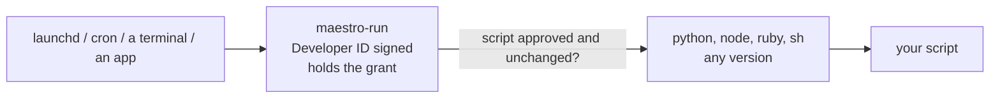

# MaestroRun

One stable macOS privacy identity for your scheduled scripts.

## The problem

You give a script Full Disk Access by granting it to the interpreter. Then the
interpreter is upgraded and macOS asks again. This is not bad luck. Homebrew
and most version managers sign their binaries ad hoc, an ad-hoc binary has no
stable identity, so macOS pins the grant to the exact code hash. A new build is
a new hash, and the grant is dead on arrival.

## What MaestroRun does

`MaestroRun.app` is a small launcher signed with a Developer ID. macOS stores
its grant against the bundle identifier and the signing team, not a hash, so
the grant survives every rebuild and every move.



You grant Full Disk Access once, to MaestroRun. It then:

1. makes itself the process macOS holds responsible, wherever it was started;
2. checks the script against an allowlist of approved paths and SHA-256 hashes;
3. replaces itself with the script, which inherits the grant.

The interpreter can change as often as it likes.

## Install

Download `MaestroRun-<version>-macos-universal.zip` from
[Releases](https://github.com/RunMaestro/MaestroRun/releases), unzip it, and put
`MaestroRun.app` anywhere, for example `~/Applications`. Then add it under
**System Settings > Privacy & Security > Full Disk Access**.

A symlink keeps the grant, so this is safe:

```bash
ln -s ~/Applications/MaestroRun.app/Contents/MacOS/maestro-run /usr/local/bin/maestro-run
maestro-run doctor
```

`doctor` exits 0 when Full Disk Access is in effect and 3 when it is not.

## Use

```bash
# Approve a script at its current contents. Pick the interpreter by path.
maestro-run approve --interpreter /opt/homebrew/bin/python3 ~/tools/backup.py

# Run it. This is the line that goes in a LaunchAgent or a crontab.
maestro-run run ~/tools/backup.py --full

# See what is approved and whether anything changed.
maestro-run list
```

A script runs only while its contents match what was approved. Edit it and
`run` refuses with exit code 126 until you approve it again. Without
`--interpreter` the script is executed directly, so it needs a shebang.

In a LaunchAgent:

```xml
<key>ProgramArguments</key>
<array>
	<string>/Users/you/Applications/MaestroRun.app/Contents/MacOS/maestro-run</string>
	<string>run</string>
	<string>/Users/you/tools/backup.py</string>
</array>
```

## What it protects, and what it does not

MaestroRun is a registry and a tamper check. It is not a sandbox. Read
[docs/THREAT-MODEL.md](docs/THREAT-MODEL.md) before you rely on it. In short:

- A script that changed after approval does not run.
- Every allowed and denied run is written to `~/Library/Logs/MaestroRun/`.
- With the default per-user allowlist, another process running as you can
  approve its own script. A root-owned system allowlist closes that.
- The interpreter and the modules a script imports are not pinned.

## Verify a release

```bash
codesign --verify --strict -R='identifier "com.maestro.run" and anchor apple generic and certificate leaf[subject.OU] = "4N4DQ24LED"' MaestroRun.app
spctl --assess --type execute --verbose=2 MaestroRun.app
```

Both must succeed. Anything that installs MaestroRun for a user must run the
same two checks first.

## Build

```bash
make          # build/MaestroRun.app, universal, ad-hoc signed
make test     # behavior tests, no privacy grant needed
```

An ad-hoc build is for development. It cannot hold a grant that survives a
rebuild, which is the whole point of the signed release.

## More

- [docs/CONTRACT.md](docs/CONTRACT.md): the command line, exit codes and file
  formats that other tools may depend on.
- [docs/TCC-FINDINGS.md](docs/TCC-FINDINGS.md): the experiments behind the design.
- [docs/THREAT-MODEL.md](docs/THREAT-MODEL.md): what is and is not defended.

## License

AGPL-3.0. See [LICENSE](LICENSE).
